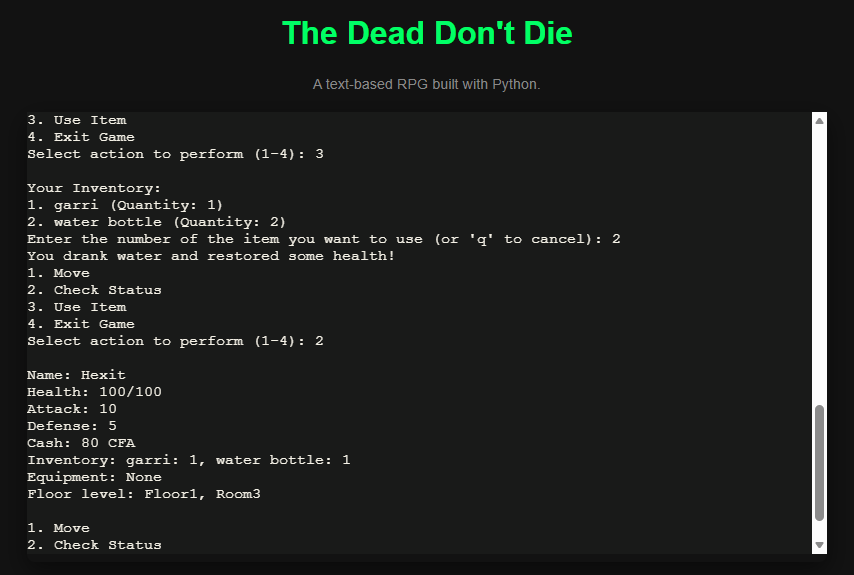
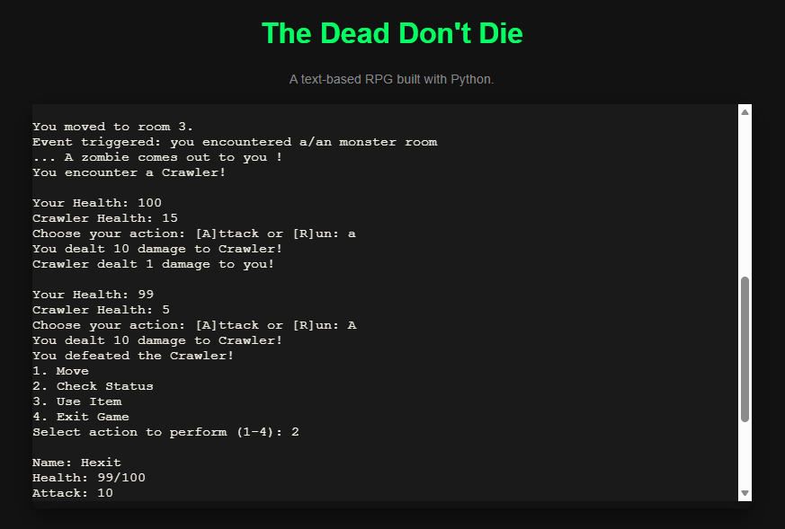
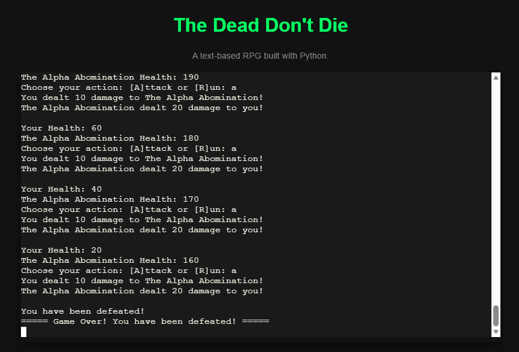

# The Dead Don't Die - Text-Based RPG

A survival horror text-based RPG where you climb a zombie-infested building in Douala to find your kidnapped junior brother.


**[Play Demo](https://demo-delta-rose-90.vercel.app/)** *(Tip: Wait for the welcome message to print first!)*

---

## What is this project?

**The Dead Don't Die** is a command-line RPG built with **basic Python only** (no Pygame, no external libraries). The goal is simple but tense: you start on Floor 1 and you must clear 5 rooms per floor to advance. Each room is randomly generated as a monster fight, treasure room, merchant, or empty room.

I built it for my non-traditional game idea: instead of an open world, the player is forced to search every room of a building. Your brother is somewhere near the top, so you have to survive, loot, and manage your inventory to save him.

---

## How I built it

- **Data Structure:** The player state is stored in a single Python `dict` tracking health, attack, defense, cash, inventory, equipment, and location (current floor/room).
- **Inventory & Equipment Logic:** I used two dictionaries to separate game mechanics:
  - `inventory = {item: quantity}` for consumables like garri and water.
  - `equipment = {slot: weapon}` for equipped items providing stats like permanent ATK or DEF.
- **Procedural Generation:** Rooms generate using weighted probabilities (55% monster, 25% treasure, 10% merchant, 10% empty) via Python's `random.randint`.
- **Scaling Difficulty:** Monsters scale by floor tiers (Tier 1 on floors 1–2, Tier 2 on floors 3–4, Tier 3 on floor 5+, and a Boss encounter on every 3rd floor).
- **Game Architecture:** The entire game runs in a core `while` loop within `main()`, supported by functions like `movement()`, `battle()`, `merchant_interaction()`, and `room_event_handling()`.

---

## Gameplay Previews

- **Action & Movement:** The player can use inventory items and check status before moving throughout the game.  
  

- **Exploration & Events:** Search rooms floor by floor to encounter enemies, safe boxes, or merchants.  
  

- **Game Ending:** The game ends either when your junior brother is rescued or when you are defeated in combat.  
  

---

## 🕹️ Controls Reference

| Action | Input | Description |
| :--- | :--- | :--- |
| **Main Menu** | `1` - `4` | Navigate game choices (Move, Stats, Item, Exit). |
| **Movement** | `p` / `n` | Go to **p**revious room or **n**ext room. |
| **Combat** | `a` / `r` | **A**ttack enemy or **r**un away. |
| **Merchant** | `1` - `5` | Buy food, armor, or knuckle weapons using CFA cash. |

---

## Why I built it

This project was a fun way for me to tie together everything I've learned so far in Python. It proves that I can build something concrete, functional, and entertaining with fundamental programming concepts while learning and applying new software logic along the way.

---

## How to run / play locally

### 1. Requirements
- **Python 3.7+** installed

### 2. Install and Run

**Clone the repository:**
```bash
git clone [https://github.com/Gilles-PFT/Python-Projects.git](https://github.com/Gilles-PFT/Python-Projects.git)
cd "Python-Projects/The dead don't die!"
```

**Run the game:**
```bash
"The_dead_don't_die.py"
